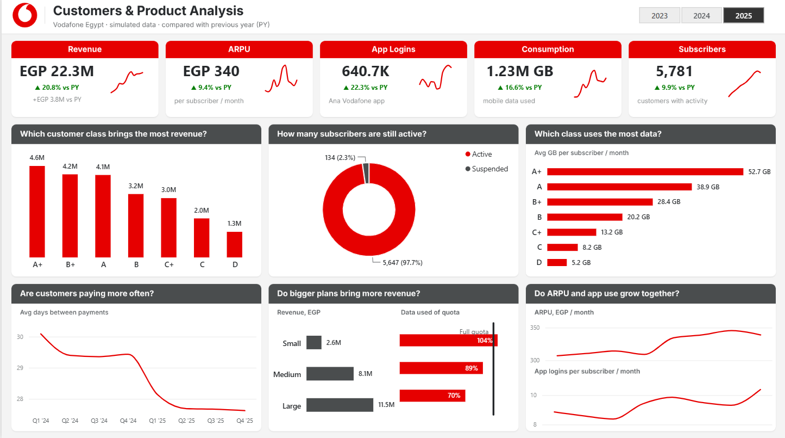

# Vodafone Egypt — Customers & Product Analysis

One-page Power BI dashboard, built in Vodafone's visual identity, that tracks **revenue, ARPU, app logins, data consumption and subscribers** for 2023–2025 against the previous year. Every chart title is written as the business question it answers.

> **Simulated data.** All data was generated in Python for this portfolio project. It is not real Vodafone data, and the trends below come from rules built into the data generator.

## Business questions

The KPI row answers: *how did revenue, ARPU, app logins, data consumption and subscribers change versus the previous year?* The six charts answer:

- Which customer class brings the most revenue?
- How many subscribers are still active?
- Which class uses the most data?
- Are customers paying more often?
- Do bigger plans bring more revenue?
- Do ARPU and app use grow together?

## The dashboard

**Header.** Vodafone logo, title, and single-select year buttons (2023 / 2024 / 2025; 2025 when nothing is selected).

**KPI cards.** Each card shows the selected year's value, a green/red "▲/▼ x% vs PY" line, and a monthly sparkline.

| KPI | 2025 | vs 2024 |
|---|---|---|
| Revenue | EGP 22.3M | ▲ 20.8% (+EGP 3.8M) |
| ARPU (per subscriber / month) | EGP 340 | ▲ 9.4% |
| App Logins (Ana Vodafone app) | 640.7K | ▲ 22.3% |
| Consumption (mobile data) | 1.23M GB | ▲ 16.6% |
| Subscribers (with activity) | 5,781 | ▲ 9.9% |

**Charts.**
- **Revenue by customer class** — column chart, A+ to D, sorted high to low.
- **Active vs suspended subscribers** — donut with count and share.
- **Average GB per subscriber per month by class** — bar chart.
- **Average days between payments** — quarterly line, selected year and the year before.
- **Revenue and quota usage by plan size** — two bar charts (Small / Medium / Large) with a 100% "Full quota" reference line.
- **ARPU and app logins per subscriber** — two stacked quarterly line charts.

## Key findings (2025 vs 2024, simulated)

- Revenue grew **20.8%** to EGP 22.27M, driven by more subscribers (+9.9%) and higher ARPU (+9.4%, EGP 310 → 340).
- Customers pay more often: average days between payments fell from **29.6 to 27.8** (30.1 in Q1 '24 → 27.6 in Q4 '25).
- **97.7%** of 2025 subscribers are active (5,647 active, 134 suspended).
- A+ customers bring the most revenue (EGP 4.59M) and use the most data (52.7 GB / month, 10× class D).
- Large plans bring the most revenue (EGP 11.54M), but **Small-plan customers use 104% of their quota** vs 70% for Large plans: a clear upsell signal.
- ARPU and app use rise together: app logins per subscriber per month went from 8.9 (Q1 '24) to 10.4 (Q4 '25).

## Data

`data/Vodafone_Simulated_Data_2022_2025.xlsx` — 5 Excel tables, January 2022 to December 2025 (2022 is there only so 2023 has a previous year). Currency: EGP.

| Table | Rows | Grain |
|---|---|---|
| Fact_Monthly | 228,621 | one customer in one month (plan fee, extra charges, revenue, data used, quota, app logins) |
| Fact_Payments | 231,401 | one payment (amount, method, days since last payment) |
| Dim_Customer | 6,000 | one customer (gender, age group, governorate, type, class A+–D, join date, status) |
| Dim_Plan | 8 | one plan: Flex 50–300 (prepaid, 3–30 GB) and RED 400–1000 (postpaid, 40–100 GB) |
| Dim_Date | 1,461 | one day |

The data was validated with a Python script before loading: no nulls or duplicates, all foreign keys match, Revenue = Plan Fee + Extra Charges on every row, no records before a customer's join date, and suspended customers stop on their suspension date. Totals were checked again in Power BI with DAX queries.

## Data model

Star schema with two fact tables (`Fact_Monthly`, `Fact_Payments`) and three dimensions (`Dim_Customer`, `Dim_Plan`, `Dim_Date`), all many-to-one, single direction.

- `Dim_Date` is marked as the date table.
- The plan links through `Fact_Monthly`, not `Dim_Customer`, to avoid ambiguous filter paths.
- `Years` is a disconnected table (GENERATESERIES) that drives the year buttons.
- All 48 measures sit in a `_Measures` table, in folders: Base, KPI Cards, Charts.

## Techniques used

- **DAX:** current-year / previous-year pattern with `SELECTEDVALUE` and `CALCULATE` over a disconnected year table; `DIVIDE` ratios (ARPU, quota utilization, logins per subscriber); `FORMAT` labels; a measure that returns a hex colour for green/red conditional formatting; "2Y" measures so the trend lines show exactly 8 quarters.
- **Modelling:** star schema, marked date table, calculated columns with sort-by columns (quarter labels, plan size).
- **Design:** mockup first, then build. Custom JSON theme (Vodafone red `#E60000`, dark grey `#4A4D4E`, green `#007C00`), background image, and 25 visuals placed at exact positions.
- **Power BI Project (PBIP / PBIR):** the report and model are saved as text files (JSON and TMDL), so changes are readable in Git.
- **Python** (pandas, numpy) for data simulation and validation.

## Files

- `Vodafone_Dashboard.pbip` — open this in Power BI Desktop. It loads the report and model from the two folders below.
- `Vodafone_Dashboard.Report/` — the report page: 25 visuals, theme and background, saved as JSON (PBIR)
- `Vodafone_Dashboard.SemanticModel/` — tables, relationships and all 48 DAX measures, saved as TMDL
- `data/Vodafone_Simulated_Data_2022_2025.xlsx` — the data source (5 tables)
- `design/` — the approved mockup and the page background image
- `screenshots/` — the dashboard page from Power BI Desktop

To open it, point the Excel data source in Power Query to where you saved `data/Vodafone_Simulated_Data_2022_2025.xlsx`, then refresh.

## Author

Mohamed Yasser Kamal — [mohamedyasser6044@gmail.com](mailto:mohamedyasser6044@gmail.com)
